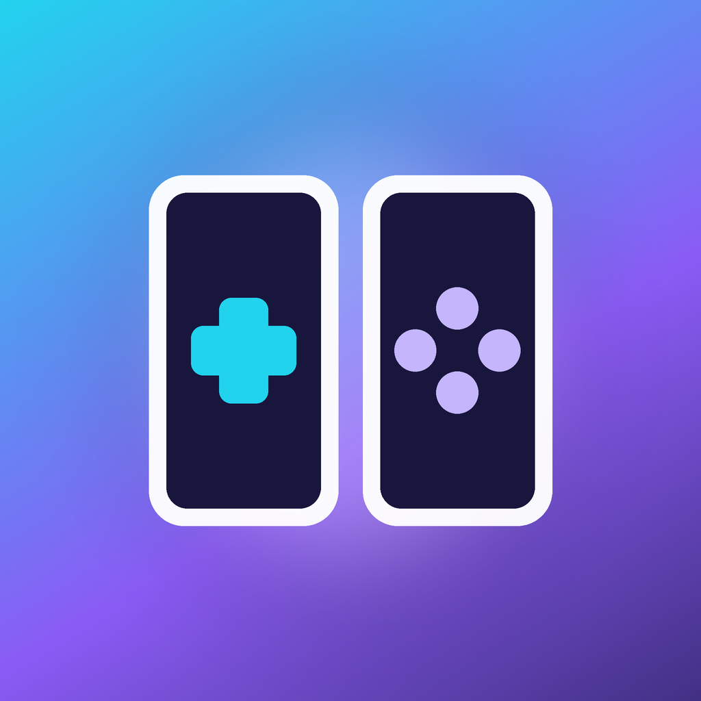

<p align="center">
  
</p>

<h1 align="center">WiiPad</h1>

<p align="center">
  An unofficial, non-commercial Wii U emulator fork for the iPhone Duo (and iPad / iPhone).
  Built on <a href="https://github.com/EspressU/EspressU-Emu">EspressU</a> and <a href="https://github.com/cemu-project/Cemu">Cemu</a>.
</p>

<p align="center"><b>This product includes work by EspressU (https://espressu.dev).</b><br>
EspressU (https://espressu.dev) · Crema touch controls by EspressU (https://espressu.dev)<br>
EspressU is based on <a href="https://github.com/MuffinEMU/Muffin-EMU">MuffinEMU</a> by Void. EspressU does not endorse WiiPad.<br>
Source: <a href="https://github.com/alexxzandrr/Cemu/tree/duo">github.com/alexxzandrr/Cemu (branch duo)</a></p>

---

- Metal renderer with a persistent shader cache
- ARM64 recompiler (JIT), built in, iOS 17.4 and later
- Controller support (DualSense, Xbox, MFi) and an on-screen GamePad
- Games as `.wua` files, decrypted folders, or encrypted with your own `keys.txt`; updates and DLC can be imported

WiiPad contains no firmware, keys or games. You need your own dumps from your own Wii U.

## Install

You need an iPad or iPhone on iOS 17.4 or later with Developer Mode turned on.

1. Download the unsigned `WiiPad-Duo-unsigned-*.ipa` artifact from the `duo-build` GitHub Actions run.
2. Install it with iloader (Import IPA) or SideInstaller.
3. Turn on the increased memory limit when installing. Without a higher limit, most games run out of memory.
4. Open WiiPad, go to Settings › JIT, import your pairing file and connect LocalDevVPN. JIT starts on its own when you launch a game. Without JIT the much slower interpreter runs.
5. Add your games from the library with the Add button.

## Build

You need a Mac with Xcode. Once:

```sh
brew install cmake ninja xcodegen pkg-config autoconf automake libtool
xcodebuild -downloadComponent MetalToolchain
```

Then:

```sh
git clone --recursive https://github.com/EspressU/EspressU-Emu.git
cd EspressU-Emu
ci/build-stikjit.sh
cmake -S . -B build-ios -G Ninja \
  -DCMAKE_SYSTEM_NAME=iOS -DCMAKE_OSX_SYSROOT=iphoneos -DCMAKE_OSX_ARCHITECTURES=arm64 \
  -DCMAKE_OSX_DEPLOYMENT_TARGET=17.4 -DVCPKG_TARGET_TRIPLET=arm64-ios \
  -DBUILD_HEADLESS_DYLIB=ON -DCMAKE_MACOSX_BUNDLE=OFF -DCMAKE_BUILD_TYPE=Release
cmake --build build-ios --target CemuBin
mkdir -p build-ios/out && rm -rf build-ios/out/Cemu.framework && cp -R build-ios/src/Cemu.framework build-ios/out/
cd src/ios && xcodegen generate
xcodebuild -project EspressU.xcodeproj -scheme EspressU -sdk iphoneos -configuration Release CODE_SIGNING_ALLOWED=NO build
```

The result is an unsigned `EspressU.app`. Zip it into a `Payload` folder as an `.ipa` and sign it with your own certificate. It needs the entitlements `get-task-allow`, `com.apple.developer.kernel.increased-memory-limit` and `com.apple.developer.kernel.extended-virtual-addressing`.

## License

WiiPad changes are by alexxzandrr; modified files carry a "Changed by WiiPad" note where their licence asks for one. The licence terms below are EspressU's and apply to WiiPad unchanged.


[MPL-2.0](LICENSE.txt), with two exceptions. First, files EspressU wrote itself (marked in their header, not Muffin or third-party files) are under the [EspressU Licence](LICENSES/EspressU-Licence.txt): non-commercial use only, fully open source, keep the notice, credit "EspressU (https://espressu.dev)". These are `src/ios/App/ControllerMapping.swift`, `EspressUGamePacksView.swift`, `GameFilesController.swift`, `Settings/PerformanceTuning.swift`, `Settings/SessionReport.swift`, `Settings/LegacyLogCleanup.swift`, `src/ios/Bridge/IOSReport.cpp` and `IOSReport.h`. Second: the on-screen touch controls (Crema, in [src/ios/App/Crema](src/ios/App/Crema)) are EspressU's own work under the [Crema Licence](src/ios/App/Crema/LICENSE.txt), which allows non-commercial use only, requires full open source and a prominent credit. EspressU is built on Cemu; the copyright notices in the source files stay in place. Contributions are described in [CONTRIBUTING.md](CONTRIBUTING.md). Libraries and their licenses are listed in [docs/docs/licenses.html](docs/docs/licenses.html) and in the app under Settings › About.

Wii U is a trademark of Nintendo. WiiPad and EspressU are not affiliated with Nintendo.
